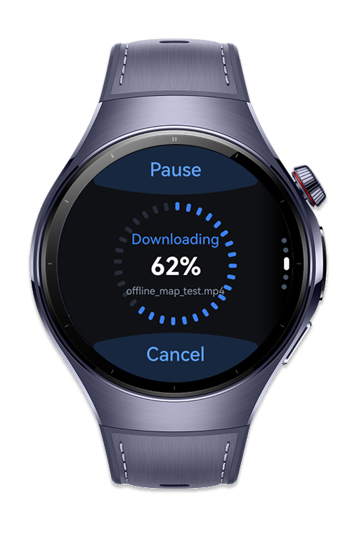
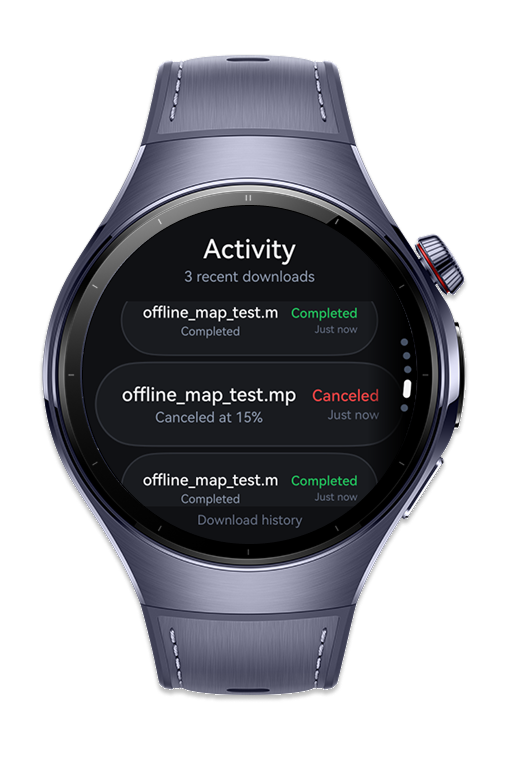
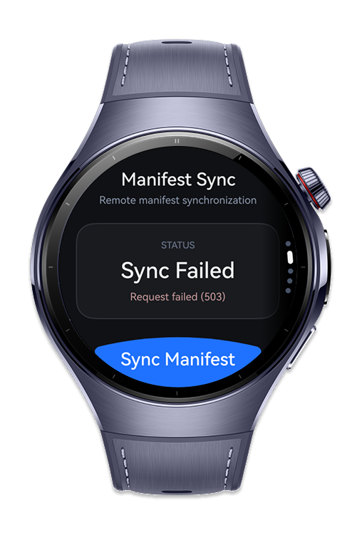
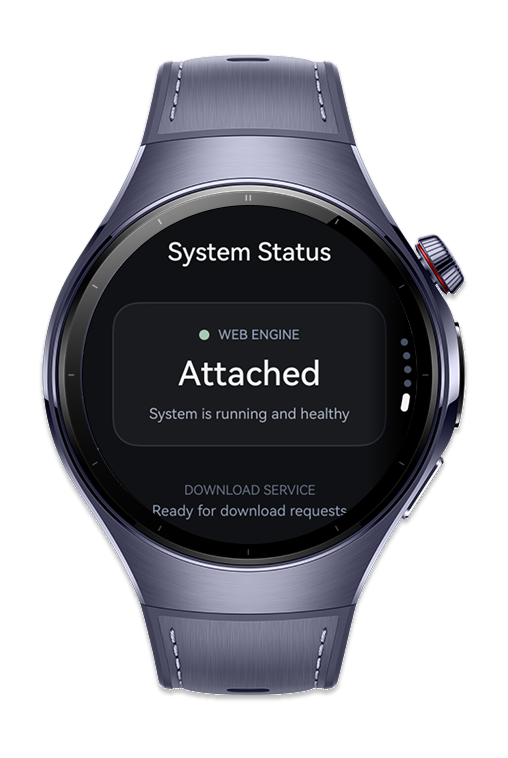

> **Note:** To access all shared projects, get information about environment setup, and view other guides, please visit [Explore-In-HMOS Index](https://github.com/Explore-In-HMOS/hmos-index).

# How To Build Web Download Manager
A wearable file download manager for web content that uses WebDownloadManager for initiating and queuing downloads from web pages, WebDownloadDelegate for receiving progress callbacks (bytes received, total size, speed), WebDownloadItem for inspecting individual download metadata (URL, MIME type, suggested filename), and WebHttpBodyStream for streaming HTTP response bodies in chunks for memory-efficient processing. The codelab demonstrates downloading podcast episodes or offline maps from a web page directly to the watch, with a progress ring UI and pause/resume controls.
# Preview
<div>
    
    
    
    
</div>

# Use Cases
## Attach the Engine
1. The user opens How to Build Download Manager application on the smart wearable device.
2. The application attached WebEngine.
3. The user checks that application connect WebEngine.
4. The user see "Web Engine Attached" text on the page.

## Download
1. The user opens How to Build Download Manager application on the smart wearable device.
2. The application attached WebEngine.
3. The user opens "Download Page".
4. The user touch "Download Button".
5. The application starts download process.
6. The application shows the user the progress of the process ring download.
7. When the download is successfully completed, the process ring turns green and displays 100% in the middle.
## Download Management
1. The user opens How to Build Download Manager application on the smart wearable device.
2. The application attached WebEngine.
3. The user opens "Download" page and touch "Download Button".
4. The application starts download process.
5. The user can control download process. The user can stop or cancel the process. 
6. If the user wishes to stop the download, they can press the stop button on the screen.
7. If the user wishes to cancel the download, they can press the cancel button on the screen.
8. When touched stop button, The User can touch resume button or cancel button. If touch resume button, download process will continue. If touch cancel button, download process is cancel. 
9. When touched cancel button, The User can touch restart button. If touch restart button, download process will restart.
## Post Manifest
1. The user opens How to Build Download Manager application on the smart wearable device.
2. The application attached WebEngine.
3. The user opens "Sync Manifest" page.
4. The user see "Ready" status and touch "Sync Manifest" button.
5. Application post the data on the address and write "Succsess or Sync Failed" status with error code.l
# Technology
## Stack
- **Languages**: ArkTS
- **Frameworks**: HarmonyOS SDK 5.1.0(18)
- **Tools**: DevEco Studio Version 6.1.1
- **Libraries**:
## Required Permissions
"ohos.permission.INTERNET",
"ohos.permission.KEEP_BACKGROUND_RUNNING"
# Directory Structure
```
├───components
│       CommonConstants.ets
│       DownloadEngineHost.ets
│
├───entryability
│       EntryAbility.ets
│
├───entrybackupability
│       EntryBackupAbility.ets
│
├───model
│       BottomTabModel.ets
│       DownloadTypes.ets
│
├───pages
│   │   Index.ets
│   │   WebManager.ets
│   │
│   ├───Home
│   │       Home.ets
│   │
│   └───wearable
│           ActivityPage.ets
│           DownloadControlPage.ets
│           InvokePage.ets
│           ManifestSyncPage.ets
│           OverviewPage.ets
│           SystemStatusPage.ets
│
├───services
│       WebDownloadService.ets
│ 
└───viewModel
        BottomTabItems.ets
        HomeTabViewModel.ets
```
# Constraints and Restrictions
## Note
Please add your download and post address in the DownloadControlPage, ManifestSyncPage, OverviewPage and WebManager files.
## Supported Devices
- Huawei Watch 5
- DevEco Studio Simulator
# License
How to build web download manager  distributed under the terms of the MIT License
See the [LICENSE](./LICENSE) for more information.